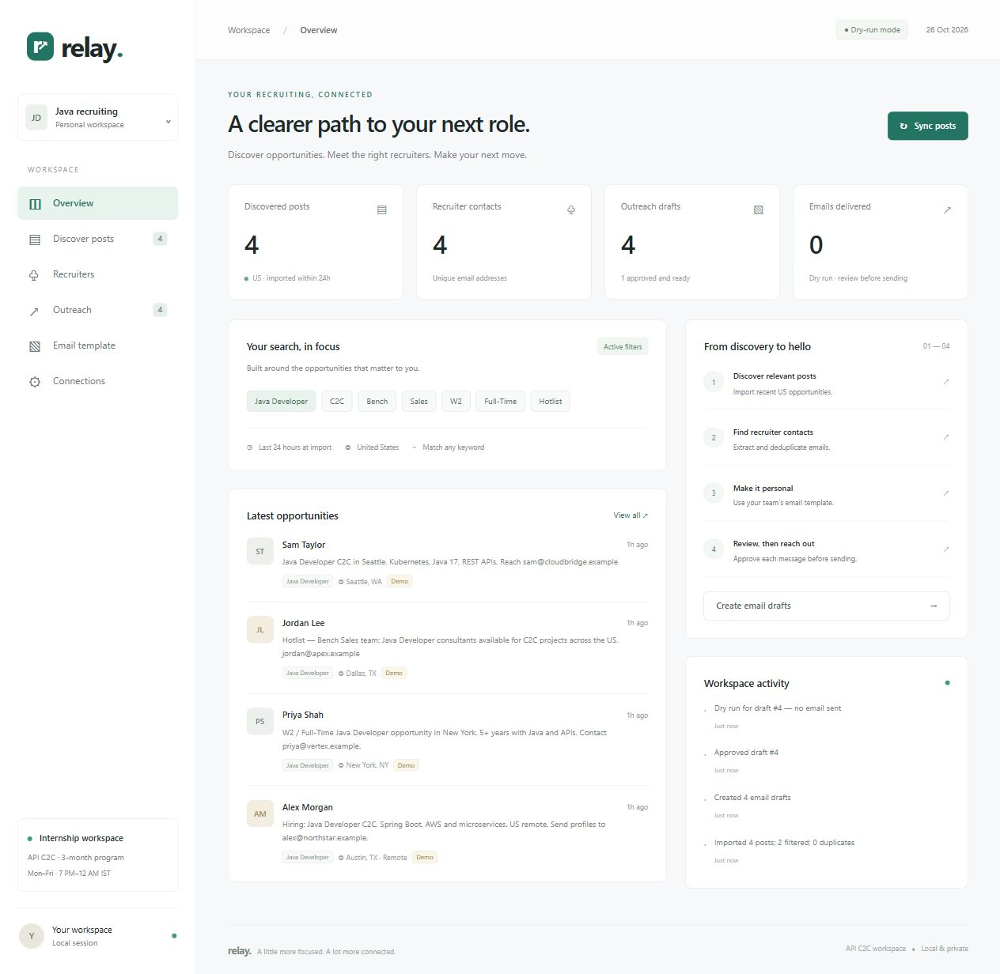

# Relay | API C2C Recruiter Workspace

**A Java application for discovering opportunities, organizing recruiter contacts, and preparing reviewed email outreach.**

Built for the API C2C internship assignment, Relay brings post filtering, contact extraction, email templates, and outreach tracking into one local workspace. The included demo runs without external credentials.

**Java 17 · Spring Boot 3.4.2 · H2 Database · Maven · HTML, CSS & JavaScript**

[Quick start](#quick-start) · [Demo walkthrough](#demo-walkthrough) · [Assignment coverage](#assignment-coverage) · [Integration setup](docs/CONFIGURATION.md) · [API reference](docs/API.md)



*Dashboard with fictional demo contacts. Live email delivery is disabled by default.*

## Overview

```text
Authorized post data
        ↓
US + last 24 hours + keyword matching
        ↓
Recruiter email extraction and deduplication
        ↓
Personalized drafts from a team template
        ↓
Individual review and approval
        ↓
Dry run or configured SMTP delivery
```

### Key features

- **Focused discovery:** filter imported posts by country, publication time, and the assignment's seven keywords.
- **Recruiter directory:** extract email addresses from post text, deduplicate contacts, and export CSV.
- **Personalized outreach:** save a reusable template, generate drafts, and edit each message before approval.
- **Controlled delivery:** dry-run mode, individual approval, contact suppression, and duplicate-send prevention.
- **Integration support:** LinkedIn OAuth sign-in, an authorized post-provider adapter, and SMTP delivery.
- **Persistent workspace:** retain posts, contacts, templates, drafts, and activity in a local H2 database.

## Assignment coverage

| Requirement | Implementation | Setup needed |
| --- | --- | --- |
| LinkedIn login | OAuth 2.0 sign-in with OpenID Connect and validated callback state | LinkedIn developer app and initial user consent |
| Relevant post discovery | Authorized provider sync, JSON import, and search within imported posts | Provider endpoint for external discovery; imports work locally |
| Required keywords | Java Developer, C2C, Bench, Sales, W2, Full-Time, Hotlist | Included |
| Last 24 hours | Publication timestamp checked at ingestion | Current UTC timestamps in source data |
| US-based opportunities | Explicit `country: "US"` filter | Country metadata from the source |
| Recruiter details | Names and companies from post metadata; emails extracted from post text | Email addresses must be present in source posts |
| Team email format | Editable templates with contact placeholders | Replace the starter with the team's supplied format |
| Email delivery | Approved messages submitted through SMTP; dry-run mode included | SMTP credentials and explicit live-send configuration |

**Integration scope:** LinkedIn sign-in provides identity; it does not grant unrestricted public-post search. External discovery requires an authorized source that implements the documented provider contract. The demo exercises filtering, extraction, drafting, approval, and dry runs without those credentials. See the [integration guide](docs/CONFIGURATION.md).

## Quick start

### Prerequisites

- JDK **17 or newer**
- Maven **3.6.3 or newer**
- Git and a web browser

### Clone and run

```bash
git clone https://github.com/anjali04853/relay-recruiter-desk.git
cd relay-recruiter-desk
mvn clean verify
```

On Windows, start from PowerShell:

```powershell
.\start.ps1
```

On macOS or Linux:

```bash
java -jar target/recruiter-desk-1.0.0.jar
```

Open **[http://localhost:8080](http://localhost:8080)**.

The Windows launcher supplies project-local temporary paths for Java networking and builds the JAR if missing. Rebuild with `mvn clean verify` after source changes. Stop the application with **Ctrl+C** in its terminal.

## Demo walkthrough

1. **Load sample data:** click **Load demo** on the overview page. Four matching US posts and four contacts are added. One old post and one non-US post are filtered out.
2. **Explore opportunities:** open **Discover posts** to search post text, recruiter names, companies, and keywords.
3. **Review contacts:** open **Recruiters** to inspect extracted email addresses or download a CSV.
4. **Set the template:** open **Email template** and add the team's format and your profile details.
5. **Generate drafts:** click **Create drafts**. Each eligible contact receives at most one draft; existing drafts are preserved.
6. **Review and approve:** open **Outreach**, edit a message, and approve it. Editing an approved message resets it to draft.
7. **Test delivery:** click **Test dry run**. The action is recorded in activity; no email is sent and the draft remains approved.

Demo contacts are labeled and use reserved `.example` addresses. They are blocked from live delivery even when SMTP is enabled.

## Architecture

| Layer | Technology / responsibility |
| --- | --- |
| Web interface | Responsive HTML, CSS, and vanilla JavaScript served by Spring Boot |
| HTTP API | Spring Web MVC, OAuth callbacks, provider sync, and mail orchestration |
| Workflow service | Validation, filtering, extraction, deduplication, templates, and draft transitions |
| Persistence | Spring JDBC with an H2 file database and transactional imports |
| External integrations | LinkedIn OAuth, HTTPS post-provider endpoint, and SMTP via Spring Mail |
| Verification | JUnit 5, Spring Boot Test, MockMvc, and Mockito |

```text
src/main/java/com/c2c/desk/
├── Application.java        # Spring Boot entry point
├── Api.java                # API endpoints and integrations
├── Workflow.java           # Workflow and persistence
└── WebConfig.java          # Request checks and response headers
src/main/resources/
├── application.properties  # Environment-based configuration
├── schema.sql              # Database schema
└── static/                 # Dashboard interface
src/test/java/com/c2c/desk/
└── WorkflowTest.java        # Workflow and HTTP integration tests
docs/                       # Setup, API reference, and preview
```

## Validation

```bash
mvn test
```

The verified build passed **7 tests with 0 failures and 0 errors**, covering:

- Country, age, future-timestamp, and keyword filtering.
- Post/contact deduplication and transactional rollback of malformed batches.
- Template rendering, approval reset after edits, and contact suppression.
- Demo ingestion, serialization, request-header enforcement, CSV export, and invalid OAuth callback rejection.
- Dry runs, successful mocked SMTP delivery, repeat-send blocking, and uncertain SMTP outcomes.

A browser walkthrough also verified demo imports, the recruiter table, draft generation, approval, and dry-run delivery. LinkedIn and real SMTP delivery require credentials and have not been verified against live accounts.

## Configuration and operating notes

Use [`.env.example`](.env.example) as the configuration reference. Set values in the environment of the terminal launching the app; Spring Boot does **not** automatically load `.env` files.

- The app binds to **127.0.0.1** and is intended for a single-user local demonstration. LinkedIn sign-in is an integration connection, not application access control.
- Local data is stored under `data/`. Data files, build outputs, logs, and `.env` are excluded from Git.
- The 24-hour rule applies at ingestion. Imported posts remain available as history.
- Country metadata must explicitly identify the US. Names and companies reflect source metadata and should be reviewed before outreach.
- Live delivery requires approval and configuration. A rolling limit counts up to 25 sent, in-flight, or uncertain attempts per 24 hours. `SENT` indicates successful SMTP submission, not confirmed inbox receipt.
- Uncertain or interrupted sends require checking provider logs before reconciliation; they are not retried automatically.

See the [configuration guide](docs/CONFIGURATION.md) and [API reference](docs/API.md) for complete setup and request details.
